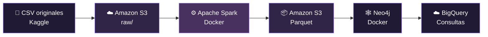

# 🕸️ ANALISIS INFLUENCIA Y DESINFORMACIÓN EN REDES SOCIALES

### BIG DATA · ANALISIS GRAFOS

  Análisis de interacciones y patrones de difusión
  en redes sociales mediante procesamiento distribuido.

---

## 01. Descripción del problema

El problema que se busca abordar consiste en analizar el comportamiento y las interacciones que se generan en las redes sociales a partir de publicaciones y comentarios relacionados con temas específicos. Se pretende comprender cómo estas interacciones pueden contribuir a la difusión de información, influir en la percepción de los usuarios y generar patrones de comunicación entre diferentes cuentas.

## 02. Arquitectura

## 03. Integrantes

- Daiana Valentina Bandama Castro
- Karol Johana Barrero Garzón